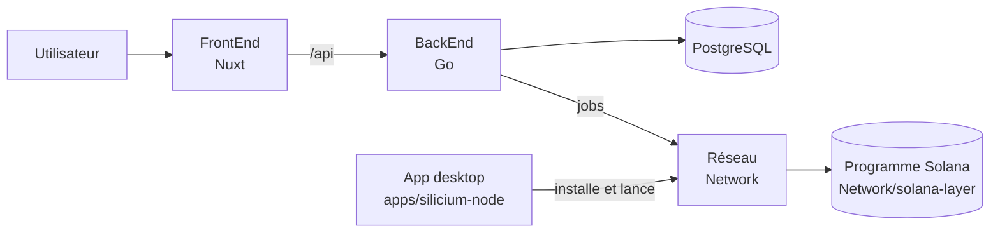

# Vue d'ensemble — comment Silicium s'assemble

| Composant | Où | Déployé par |
| --- | --- | --- |
| FrontEnd | `FrontEnd/` | `deploy/compose/docker-compose.yml` (service `frontend`) |
| BackEnd | `BackEnd/` | `deploy/compose/docker-compose.yml` (service `backend`) |
| Orchestrateur réseau (VPS) | `Network/crates/p2p-node` (binaire `p2p_node`) | `deploy/systemd/silicium-orchestrator.service` |
| Pont de réputation | `Network/crates/reputation-bridge` | `deploy/compose/docker-compose.yml` |
| Nœuds de calcul | `Network/crates/p2p-node` + `compute-daemon` via l'app desktop | installeurs publiés par `deploy/` (Windows, AppImage, .deb, .rpm) |
| Reverse proxy, TURN, VPN dev | `deploy/nginx`, Compose, `deploy/vpn` | `deploy/` |

Le fonctionnement détaillé du réseau (ce qui tourne, le parcours d'un job) est décrit dans
[`Network/docs/architecture/overview.md`](../../Network/docs/architecture/overview.md).
Le contrat de fichiers entre le BackEnd et le réseau est dans
[`Network/docs/contracts/backend-files.md`](../../Network/docs/contracts/backend-files.md).
