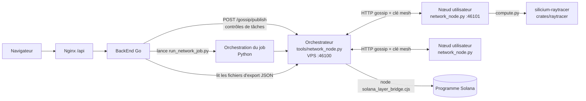
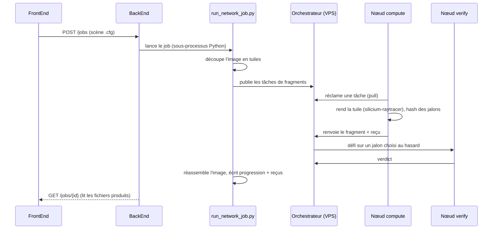
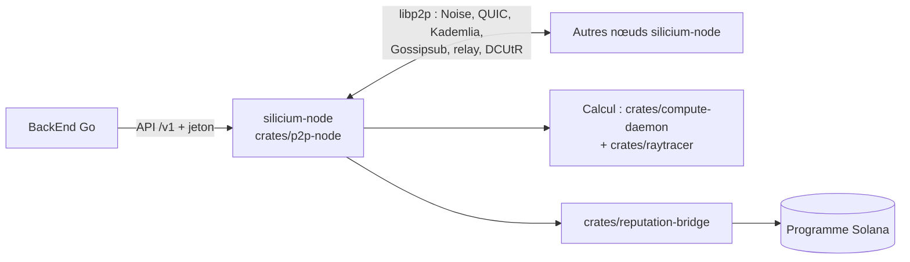

# Vue d'ensemble de l'architecture

Ce document décrit **ce qui tourne réellement aujourd'hui** (branche `main`) et
**l'architecture cible**. Le passage de l'un à l'autre est décrit dans
[`rust-migration.md`](rust-migration.md).

## Composants du projet Silicium

| Composant | Dépôt / dossier | Langage | Rôle |
| --- | --- | --- | --- |
| FrontEnd | `Fusion/FrontEnd` | Nuxt 3 / TypeScript | Création et suivi des calculs par l'utilisateur |
| BackEnd | `Fusion/BackEnd` | Go | Comptes, sessions JWT, jobs ; pilote le réseau |
| Nœud réseau | `Network/` | Python (actuel) → Rust (cible) | Découverte des pairs, distribution, calcul, vérification |
| App desktop | `Fusion/apps/silicium-node` | Tauri (Rust + Vue) | Installe et supervise le nœud chez l'utilisateur |
| Couche Solana | `Network/solana-layer` | Anchor (Rust) + SDK TypeScript | Jobs on-chain, réputation, staking, récompenses |
| Déploiement | `Fusion/deploy` | Docker Compose, systemd, Nginx | Serveur (VPS), CI/CD, canaux dev/prod |

## Architecture actuelle (production, `main`)

Points clés :

- **Tout le plan réseau est en Python** : `tools/network_node.py` sert à la fois
  d'orchestrateur sur le VPS et de nœud de calcul chez les utilisateurs
  (lancé par l'app Tauri via `silicium node start`).
- **Le calcul lui-même est déjà en Rust** : le rendu passe par le binaire
  `silicium-raytracer` (`crates/raytracer`).
- **Le BackEnd lit des fichiers écrits par le runtime Python** (progression,
  fragments, reçus, heartbeat des pairs). C'est un contrat implicite ; voir
  [`../contracts/backend-files.md`](../contracts/backend-files.md).
- Les appels Solana passent par Node.js (`tools/solana_layer_bridge.cjs`).

## Parcours d'un job (actuel)

## Architecture cible (Rust)

Principes de la cible :

- un seul binaire `silicium-node` par machine, sans Python ni Node.js ;
- un plan de contrôle HTTP versionné (`/v1`) réservé au BackEnd, authentifié ;
- un plan de données libp2p entre nœuds : les fichiers circulent par hash de
  contenu, jamais par chemin ;
- des tâches signées par l'orchestrateur, vérifiées par un pair différent de
  celui qui a calculé.

## Où trouver quoi

- Organisation des dossiers : [`repository-layout.md`](repository-layout.md)
- Plan de migration : [`rust-migration.md`](rust-migration.md)
- Contrats (API, fichiers, protocoles) : [`../contracts/`](../contracts/)
