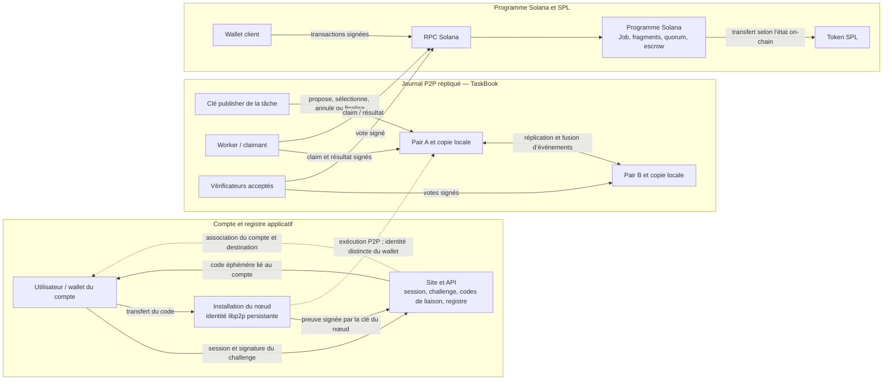

# Frontières de confiance et finalité

**État :** étude du code aux révisions indiquées ci-dessous, pas une spécification
complète ni une preuve de sécurité. **Issue :** [EXEC-01 — acteurs, frontières
de confiance et états de finalité](https://github.com/Silicium-Project/Workbench/issues/240).
**Snapshot Workbench :** `90bec77675ca7a67c7202126386ef5dd9033b761`, le 26 octobre
2026. Aucun runtime ni déploiement n’est modifié par cette étude.

Les dépôts de composants sont privés. Les liens ci-dessous sont immuables et
nécessitent leur accès GitHub ; ce document ne copie pas leur code. Les
observations décrivent seulement les révisions examinées, pas nécessairement le
déploiement Devnet ou le VPS en cours d’exécution.

| Composant | Révision examinée |
| --- | --- |
| [BackEnd](https://github.com/Silicium-Project/BackEnd/tree/a24bab6d1f7607fcdca85b52b690de2b53578558) | `a24bab6d1f7607fcdca85b52b690de2b53578558` |
| [FrontEnd](https://github.com/Silicium-Project/FrontEnd/tree/3b5f0975ca0cdbdcff430023214e718401e3e266) | `3b5f0975ca0cdbdcff430023214e718401e3e266` |
| [DesktopApp](https://github.com/Silicium-Project/DesktopApp/tree/ef12c73350bc630579a9d2c3a56d985a64a871cf) | `ef12c73350bc630579a9d2c3a56d985a64a871cf` |
| [Network](https://github.com/Silicium-Project/Network/tree/3bc1e3493842ba00adda83650d3ccf762e471421) | `3bc1e3493842ba00adda83650d3ccf762e471421` |
| [Solana](https://github.com/Silicium-Project/Solana/tree/ef8f07d4fbedf28db01ce258a1988e19e3f13f73) | `ef8f07d4fbedf28db01ce258a1988e19e3f13f73` |

## Ce que le système fait aujourd’hui

Il existe deux machines à états distinctes dans ces sources : le **TaskBook**
P2P, journal signé répliqué entre pairs, et les comptes **Job/Fragment Solana**.
Elles portent des états, des règles de vote et des paiements différents. Cette
étude n’a pas trouvé de preuve qu’un `TaskFinalized` du TaskBook et un
`JobResult` Solana soient reliés par une preuve atomique, une même identité de
tâche ou un protocole de règlement commun. Jusqu’à démonstration contraire, une
preuve dans l’un de ces systèmes ne vaut donc pas preuve dans l’autre.

Le dessin sépare les frontières observées. Il ne représente pas un canal
sécurisé de transfert de charge utile ni une liaison prouvée entre TaskBook et
Solana.

## Acteurs, clés et pouvoirs

| Acteur | Preuve et pouvoir observés | Limite et conséquence d’une panne ou compromission |
| --- | --- | --- |
| **Utilisateur / demandeur** | Une session API émet un challenge de wallet à usage unique ; le wallet signe le message, puis le compte est lié à son adresse. Le wallet client signe aussi la création et la clôture du Job Solana. [Challenge et connexion](https://github.com/Silicium-Project/BackEnd/blob/a24bab6d1f7607fcdca85b52b690de2b53578558/internal/handler/userController.go#L259-L317), [vérification de signature](https://github.com/Silicium-Project/BackEnd/blob/a24bab6d1f7607fcdca85b52b690de2b53578558/internal/handler/walletController.go#L41-L105), [finalisation](https://github.com/Silicium-Project/Solana/blob/ef8f07d4fbedf28db01ce258a1988e19e3f13f73/solana/programs/solana-layer/src/instructions/finalize_job.rs#L15-L25). | Le challenge prouve le contrôle de cette clé pour ce message ; il ne prouve ni l’identité civile, ni la propriété d’une machine. La signature client de clôture ne calcule ni ne vérifie le résultat. |
| **Site et API** | Authentifient le compte, vérifient le wallet, émettent un code d’association à usage unique et enregistrent `UserID`, `NodeID`, `PeerID`, wallet worker et destination de paiement. Le code est stocké sous forme de condensat et expire après dix minutes. [Émission du code](https://github.com/Silicium-Project/BackEnd/blob/a24bab6d1f7607fcdca85b52b690de2b53578558/internal/handler/deviceController.go#L94-L125), [modèle du registre](https://github.com/Silicium-Project/BackEnd/blob/a24bab6d1f7607fcdca85b52b690de2b53578558/internal/models/device.go#L5-L32). | C’est une autorité centrale pour l’association au compte et les opérations qui passent par cette API. Sa panne bloque ces parcours ; le code n’indique pas qu’elle transfère alors le pouvoir de publisher ou de finalisation à un autre acteur. La disponibilité du site n’est pas un consensus P2P. |
| **Installation / machine** | Possède une clé Ed25519 libp2p persistée dans `identity.key`; cette clé produit un Peer ID et signe la preuve d’association. Le `NodeID` est une valeur séparée. [Identité persistée](https://github.com/Silicium-Project/Network/blob/3bc1e3493842ba00adda83650d3ccf762e471421/crates/p2p-node/src/storage.rs#L92-L110), [preuve de liaison](https://github.com/Silicium-Project/Network/blob/3bc1e3493842ba00adda83650d3ccf762e471421/crates/p2p-node/src/main.rs#L516-L598), [NodeID local](https://github.com/Silicium-Project/DesktopApp/blob/ef12c73350bc630579a9d2c3a56d985a64a871cf/src-tauri/src/config.rs#L100-L130). | La possession de cette clé prouve le contrôle de l’identité libp2p, pas l’existence d’un ordinateur physique unique. Une image ou un volume cloné peut dupliquer un secret si sa protection ne l’empêche pas. La clé libp2p, le wallet Solana worker et le wallet du compte sont trois identités distinctes. |
| **Publisher TaskBook** | L’auteur du `TaskProposed` possède l’espace de nom de la tâche. Sa chaîne d’événements accepte les claims et vérificateurs, annule ou finalise. Les nœuds desktop indiquent exécuter les tâches signées par le publisher épinglé dans leur adresse de bootstrap. [Règles du TaskBook](https://github.com/Silicium-Project/Network/blob/3bc1e3493842ba00adda83650d3ccf762e471421/crates/node-core/src/taskbook/mod.rs#L1-L18), [bootstrap épinglé en dev et non épinglé en prod](https://github.com/Silicium-Project/DesktopApp/blob/ef12c73350bc630579a9d2c3a56d985a64a871cf/src-tauri/src/config.rs#L37-L61), [nœud qui n’exécute que les tâches signées par ce publisher](https://github.com/Silicium-Project/DesktopApp/blob/ef12c73350bc630579a9d2c3a56d985a64a871cf/src-tauri/src/node.rs#L92-L117). | C’est un pouvoir concentré par tâche, pas une décision collective du réseau. La perte ou la compromission de sa clé bloque ou altère les décisions de cette tâche. La présence d’un bootstrap ne constitue pas, à elle seule, une preuve de consensus entre pairs. |
| **Claimant / worker** | Offre un claim ; le publisher choisit le claim retenu. Le claimant accepté publie un `PayloadRef` et un condensat SHA-256. [Événements](https://github.com/Silicium-Project/Network/blob/3bc1e3493842ba00adda83650d3ccf762e471421/crates/node-core/src/taskbook/body.rs#L55-L110), [signatures des événements](https://github.com/Silicium-Project/Network/blob/3bc1e3493842ba00adda83650d3ccf762e471421/crates/node-core/src/taskbook/event.rs#L110-L155). | Une signature authentifie l’auteur et un hash engage un contenu ; aucun des deux ne prouve que le calcul est correct ou que le contenu est confidentiel. |
| **Vérificateur** | Dans TaskBook, seuls les vérificateurs acceptés par le publisher comptent. Pour le workload raytracer examiné, un échantillon déterministe dépend de l’événement d’acceptation ; le vérificateur re-render les blocs retenus. [Sélection des milestones](https://github.com/Silicium-Project/Network/blob/3bc1e3493842ba00adda83650d3ccf762e471421/crates/node-core/src/taskbook/state/verification.rs#L213-L267), [vérification raytracer](https://github.com/Silicium-Project/Network/blob/3bc1e3493842ba00adda83650d3ccf762e471421/crates/p2p-node/src/workload/raytracer/verify.rs#L1-L55). Sur Solana, un worker au rôle `verify` signe un vote et doit satisfaire le seuil de réputation de cette instruction. [Vote on-chain](https://github.com/Silicium-Project/Solana/blob/ef8f07d4fbedf28db01ce258a1988e19e3f13f73/solana/programs/solana-layer/src/instructions/vote_fragment.rs#L21-L52). | Une approbation est un témoignage signé, pas une preuve mathématique de justesse. Le vote Solana compte les clés distinctes enregistrées pour le round ; cette règle ne démontre pas une machine physique distincte par clé. Le prélèvement de milestones d’un workload n’est pas la validation universelle de toutes les charges. |
| **Pairs et bootstrap P2P** | Transportent, reçoivent et répliquent les événements signés. Le TaskBook valide signatures, séquences et liens d’événements puis dérive un état de la copie disponible. [Événements signés](https://github.com/Silicium-Project/Network/blob/3bc1e3493842ba00adda83650d3ccf762e471421/crates/node-core/src/taskbook/event.rs#L32-L56), [dérivation d’état](https://github.com/Silicium-Project/Network/blob/3bc1e3493842ba00adda83650d3ccf762e471421/crates/node-core/src/taskbook/state/mod.rs#L1-L18). | La même règle de replay sur deux ensembles différents d’événements ne garantit pas que les pairs possèdent la même copie. Dans les sources examinées, le TaskBook ne fournit pas de consensus distribué permettant d’élire un nouveau publisher. |
| **Programme Solana / RPC / SPL** | Le programme vérifie les signataires, l’état du Job et les votes, transfère des SPL depuis l’escrow et enregistre `Finalized`. Le RPC transporte lectures et transactions ; la validation du programme s’exécute sur Solana. [Vote et paiement compute](https://github.com/Silicium-Project/Solana/blob/ef8f07d4fbedf28db01ce258a1988e19e3f13f73/solana/programs/solana-layer/src/instructions/vote_fragment.rs#L213-L325), [garde de clôture et remboursement](https://github.com/Silicium-Project/Solana/blob/ef8f07d4fbedf28db01ce258a1988e19e3f13f73/solana/programs/solana-layer/src/instructions/finalize_job.rs#L57-L126). | Le programme garantit ses contraintes d’état et de transfert ; il ne re-exécute pas le calcul. Une réponse RPC n’est pas la finalité de la chaîne. La politique d’attente et d’affichage de la finalité Solana côté client est hors de ce snapshot. |

### Association du compte et paiement worker

Le parcours observé lie un compte à une installation par un code éphémère et
une signature de l’identité libp2p. Pour lier un wallet worker et la destination
du compte, le wallet worker signe aussi le message qui contient code, NodeID,
PeerID, worker et destination ; l’API conserve la preuve et l’association. Le
code ne donne pas à l’API la clé privée du wallet. [Validation et stockage de la
preuve](https://github.com/Silicium-Project/BackEnd/blob/a24bab6d1f7607fcdca85b52b690de2b53578558/internal/handler/deviceController.go#L253-L307),
[liaison au compte](https://github.com/Silicium-Project/BackEnd/blob/a24bab6d1f7607fcdca85b52b690de2b53578558/internal/handler/deviceController.go#L308-L428).

L’enregistrement on-chain de la destination reste une transaction : la
destination de compte signe et paie la création des comptes de programme ; la
preuve Ed25519 du wallet worker est vérifiée par le programme. Une modification
de destination exige le signataire de l’ancienne destination. [Instruction
d’enregistrement](https://github.com/Silicium-Project/Solana/blob/ef8f07d4fbedf28db01ce258a1988e19e3f13f73/solana/programs/solana-layer/src/instructions/register_worker_payout.rs#L18-L137).
Lors du vote d’approbation qui atteint le quorum, le programme transfère la
récompense compute vers le token account de la destination worker ; les
récompenses de vérification suivent des comptes de claims séparés.

Le coût des workers n’est pas nul dans le code actuel : le claimant paie la
création du compte de fragment racine et le vérificateur paie les comptes de
vote/résolution quand ils sont créés. La création des comptes de payout est
payée par le wallet de destination. Ces instructions ne définissent pas un
relayer ou un sponsor de frais. [Claim du fragment](https://github.com/Silicium-Project/Solana/blob/ef8f07d4fbedf28db01ce258a1988e19e3f13f73/solana/programs/solana-layer/src/instructions/claim_fragment.rs#L16-L60),
[payeurs du vote](https://github.com/Silicium-Project/Solana/blob/ef8f07d4fbedf28db01ce258a1988e19e3f13f73/solana/programs/solana-layer/src/instructions/vote_fragment.rs#L21-L87).

## États et sens de « final »

| Système | États observés | Ce que l’état prouve | Ce qu’il ne prouve pas |
| --- | --- | --- | --- |
| **TaskBook P2P** | `Open` → `Claimed` → `Completed` → `Verified` → `Finalized`, ou `Rejected`, `Failed`, `Cancelled`. `Verified` signifie que le nombre d’approbations du TaskTerms est atteint et qu’aucun rejet n’est compté. [Dérivation](https://github.com/Silicium-Project/Network/blob/3bc1e3493842ba00adda83650d3ccf762e471421/crates/node-core/src/taskbook/state/attempts.rs#L42-L88). | Avec les mêmes événements valides et la même horloge de lease, les pairs peuvent recalculer le même état local. `Finalized` signifie qu’une décision de publisher est dans le journal local accepté par le replay. | Ni unanimité des pairs ni consensus sur l’ordre global. Le statut ne suffit pas à démontrer le résultat réel. `Finalized` ne prouve pas aujourd’hui, à lui seul, que le seuil de vérification a été atteint : le replay du terminal vérifie la présence du résultat, tandis que le publisher honnête n’émet la finalisation que depuis `Verified`. Voir le constat ci-dessous. |
| **Job/Fragment Solana** | Fragments `Available` → `Claimed` → `Submitted` → `Verified` ou `Rejected` ; le Job reste `Open` jusqu’à l’instruction signée de clôture, puis devient `Finalized`. [États](https://github.com/Silicium-Project/Solana/blob/ef8f07d4fbedf28db01ce258a1988e19e3f13f73/solana/programs/solana-layer/src/state/fragment.rs#L3-L53), [états Job](https://github.com/Silicium-Project/Solana/blob/ef8f07d4fbedf28db01ce258a1988e19e3f13f73/solana/programs/solana-layer/src/state/job.rs#L5-L50). | `Verified` est une transition de programme déclenchée quand `yes_votes >= quorum`. `Job::Finalized` requiert que tous les fragments attendus soient vérifiés et que les claims de récompenses de vérification soient payés ; l’escrow restant est remboursé au client. [Quorum et transfert](https://github.com/Silicium-Project/Solana/blob/ef8f07d4fbedf28db01ce258a1988e19e3f13f73/solana/programs/solana-layer/src/instructions/vote_fragment.rs#L213-L295), [clôture](https://github.com/Silicium-Project/Solana/blob/ef8f07d4fbedf28db01ce258a1988e19e3f13f73/solana/programs/solana-layer/src/instructions/finalize_job.rs#L57-L126). | Le quorum ne re-calcule pas le travail. `final_hash` et `output_uri` sont fournis par le client à la clôture ; le code montré ne les relie pas cryptographiquement au contenu de tous les fragments. L’état du compte ne remplace pas l’attente d’une confirmation Solana suffisamment forte côté client. |

### Constat de sécurité à traiter séparément

Dans la révision Network citée, `replay_publisher_decisions` accepte un
`TaskFinalized` lorsque l’événement du claimant contenant le résultat existe ;
il ne vérifie pas à cet endroit que le résultat a atteint le nombre requis
d’approbations. À l’inverse, le service publisher examiné ne signe
`TaskFinalized` que quand son état dérivé vaut `Verified`. [Garde du replay
terminal](https://github.com/Silicium-Project/Network/blob/3bc1e3493842ba00adda83650d3ccf762e471421/crates/node-core/src/taskbook/state/roles.rs#L103-L110),
[politique du publisher](https://github.com/Silicium-Project/Network/blob/3bc1e3493842ba00adda83650d3ccf762e471421/crates/p2p-node/src/publisher/mod.rs#L159-L183).

Cette différence signifie qu’un `Finalized` TaskBook est actuellement une
décision signée du publisher, pas une preuve autonome de quorum validée par
chaque réplica. Elle doit faire l’objet d’une issue de protocole et de tests de
sécurité séparés avant d’utiliser cet état comme preuve de paiement ou de
livraison. Cette PR la documente ; elle ne change ni le reducer, ni le
publisher, ni le programme Solana et ne qualifie pas le déploiement.

## Trois scénarios adverses et oracle attendu

### 1. Une signature valide accompagne un résultat faux

**Attaque considérée.** Un claimant détient bien sa clé, signe son événement et
publie un hash cohérent avec un résultat incorrect.

**Oracle de sécurité visé.** La signature et le hash seuls ne doivent jamais
faire passer le résultat à `Verified`, provoquer un paiement ou le rendre
irréversible. Le résultat doit rester rejeté ou non final tant que les preuves
et le quorum indépendamment requis ne sont pas satisfaits. Un rejet doit
déclencher la règle de reprise ou d’échec définie par le protocole, sans payer
le calcul refusé.

**État observé / limite.** Pour le workload raytracer, le vérificateur re-render
un échantillon de milestones choisi à partir de l’événement d’acceptation ; le
nombre est environ un cinquième, borné entre 1 et 8. Cela rend certains faux
résultats détectables, pas tous : la probabilité de détection dépend du nombre
de milestones et de l’emplacement des erreurs. Le vote on-chain prend un booléen
signé et compte les votes ; il n’exécute pas la charge. Le résultat hashé ne
doit pas être décrit comme une preuve de calcul exact.

### 2. Le site ou l’API disparaît

**Oracle de sécurité visé.** L’absence de l’interface web ou de l’API ne doit
pas donner au site un pouvoir de finalité, ni transférer la clé du publisher à
un pair choisi par défaut. Les données déjà signées et répliquées ne deviennent
pas invalides du seul fait que le site est indisponible.

**État observé / limite.** L’API détient le registre central compte↔machine et
les parcours de création/rotation de codes. Le bootstrap et le publisher P2P
sont des dépendances distinctes. Les nœuds qui ont déjà les clés et les
événements peuvent continuer à lire/répliquer ce qu’ils connaissent si les
pairs restent joignables ; l’étude ne démontre pas une reprise automatique du
publisher, un accès hors ligne à toute charge utile, ni la poursuite de la
création de nouvelles tâches après la perte du service publisher. Pas de
transfert automatique d’autorité.

### 3. Une partition réseau arrive avant la finalité

**Oracle de sécurité visé.** Une partition peut retarder l’acceptation et le
règlement ; elle ne doit jamais les forcer. Aucun côté ne doit annoncer un
résultat global final sur la seule base d’une copie locale incomplète. Après
rétablissement, les pairs doivent converger vers une décision unique ou
conserver un état explicitement bloqué/rejeté.

**État observé / limite.** Le TaskBook rejoue un journal signé déterministe,
mais chaque pair peut disposer d’un ensemble d’événements différent. Le
publisher ordonne les décisions de sa propre chaîne ; le code examiné ne
fournit pas de vote de consensus du réseau pour choisir un publisher ou une
finalité commune. Sur Solana, une transaction de programme encore non confirmée
doit rester `pending` côté interface ; la politique RPC/commitment du client
n’est pas qualifiée ici. L’état d’une partition P2P ne doit pas être confondu
avec la finalité du registre Solana.

## Invariants cible à conserver dans les décisions futures

Ces invariants reprennent l’issue EXEC-01 sans fixer l’algorithme final :

1. **Site absent :** aucune autorité n’est transférée implicitement ; les tâches
   et preuves déjà signées restent vérifiables localement, et l’absence de site
   ne bloque pas une décision P2P dont les acteurs requis sont joignables.
2. **Résultat faux :** une signature valide de l’exécutant ne suffit pas à le
   finaliser ou payer ; une vérification requise manquante, contradictoire ou
   expirée garde l’état non final ou rejeté.
3. **Partition :** les états partiels ne deviennent pas acceptés pour accélérer
   la progression ; l’attente est sûre et visible, la reprise est idempotente,
   et une même unité ne peut être réglée deux fois.
4. **Paiement :** seul l’état de règlement vérifiable par le programme et la
   chaîne peut prouver un transfert. Une ligne de base de données, un événement
   local ou un affichage UI ne constitue pas un reçu on-chain.
5. **Compte et appareil :** le code temporaire associe des clés à un compte ;
   il ne doit jamais être présenté comme preuve qu’une machine physique est
   unique, ni donner au site accès aux clés privées.

## Questions ouvertes, sans décision implicite

- Quelle preuve commune relie une tâche P2P, ses feuilles, ses votes et le Job
  Solana réglé ? Qui la valide, et comment son identifiant survit aux retries et
  au re-découpage ?
- Quel protocole remplace le publisher indisponible sans permettre à une
  partition minoritaire de finaliser ? Qui peut révoquer ou faire tourner cette
  identité et selon quelle preuve ?
- Le seuil de vérification est-il un compte simple, un poids Bayésien borné par
  l’ancienneté, ou une autre règle ? Comment une machine physique distincte est
  approchée sans exiger de dépôt important ni rendre Sybil trivial ?
- Quelle part du calcul est échantillonnée, avec quelle source d’aléa qui ne
  peut être anticipée ni manipulée par le claimant ou le publisher ? Quelle
  probabilité de fausse acceptation est acceptable pour chaque workload ?
- Qui finance aujourd’hui et demain la création des comptes Solana, les frais
  de transaction et les retries RPC sans imposer une barrière d’entrée aux
  workers ?
- Quel est le contrat de confidentialité de chaque charge utile ? Le hash
  protège l’intégrité, pas la confidentialité ; chiffrement, exécution
  confidentielle et preuves ZK restent hors de cette tranche.
- Quelles règles de rotation/dissociation invalident une association compte,
  appareil, worker-wallet et wallet de paiement, y compris en cas de perte ou
  compromission de clé ?
- Quels programme id, binary hash, upgrade authority et niveau de revue/audit
  sont exigés avant de traiter la finalité Devnet comme modèle de production ?

## Cas de validation à ajouter aux issues de protocole/runtime

Cette étude ne les exécute pas. Ils servent de contrats de test pour les
tranches d’implémentation suivantes :

| Cas | Résultat attendu |
| --- | --- |
| Résultat faux signé par le claimant, sans vote | `Completed` au plus ; jamais `Verified`, `Finalized` ni payé. |
| `TaskFinalized` signé avant le seuil de vérification | Le reducer le rejette ou le garde non final ; aucune réplica ne le traite comme preuve de quorum. |
| Vrai résultat, échantillon indisponible localement | Aucun vote de rejet automatique ; état en attente et reprise bornée. |
| Vérificateur avec résultat contradictoire | Règle de rejet/retry explicite, trace conservée, aucun paiement compute indu. |
| Site/API coupé après création et réplication de la tâche | Aucun changement d’autorité ; les événements et résultats déjà disponibles restent vérifiables ; l’interface indique ce qui n’est plus disponible. |
| Publisher coupé avant une décision | Pas de nouvel accepteur ni de finalité choisie implicitement ; état en attente jusqu’à la procédure explicite de reprise. |
| Réseau P2P partitionné avant puis après votes | Aucun côté n’avance seul à la finalité globale ; convergence/idempotence après reconnexion. |
| RPC `429`, timeout, blockhash expiré ou confirmation absente | État `pending`/`unknown`, relecture de destination et de signature avant retry, pas de double versement. |
| Code d’association expiré, réutilisé ou lié à un autre NodeID/PeerID | Rejet fermé ; aucune écriture partielle dans le registre ni changement de payout. |
| Deux clés worker clonées ou plusieurs clés contrôlées par le même opérateur | Le modèle explicite le risque Sybil ; le vote ne les présente pas comme machines indépendantes sans preuve supplémentaire. |
| Création de compte Fragment/Vote sur un worker sans SOL | Le parcours sponsorisé ou le refus explicite est vérifié ; l’interface n’annonce pas une machine opérationnelle si elle ne peut pas payer/être relayée. |

## Validation de cette documentation

- La référence Workbench et les cinq sous-modules ont été vérifiés propres et
  exactement aux SHA du tableau.
- Les affirmations de code ci-dessus renvoient à des liens GitHub contenant un
  commit complet et des lignes précises.
- Cette tranche doit passer les contrôles documentaires de Workbench. Aucun test
  de runtime, build Solana, appel Devnet, signature, déploiement ou opération
  VPS ne fait partie de sa validation.
- Les constats qui demandent une modification du reducer, de l’algorithme de
  vérification, du financement worker ou des contrats de finalité restent des
  issues séparées et ne sont pas réputés corrigés par cette PR.
