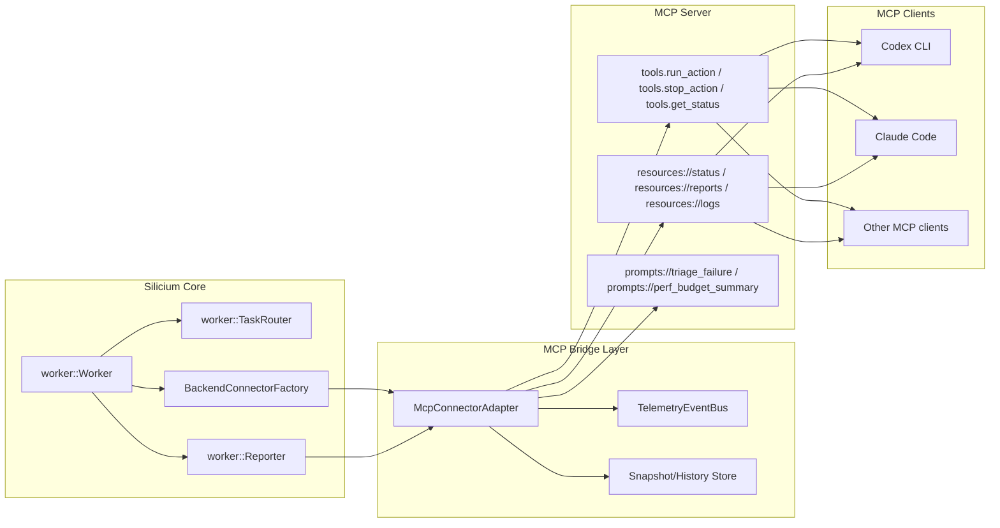

# MCP Connector Specification

This document defines a first-class MCP integration layer for Silicium so LLM clients can consume worker/executor state through a stable protocol instead of parsing ad-hoc logs.

## Scope

- Input: execution data emitted by `worker` (`TaskReport`, `TaskTelemetry`, `ExecutionResult`).
- Output: MCP resources/tools consumable by LLM clients (Codex, Claude, custom agents).
- Non-goal: replacing current CLI/TUI command execution path in phase 1.

## Goals

- Keep existing compute pipeline unchanged: `splitter -> executor -> worker`.
- Add one connector boundary that can expose live status, results, and diagnostics.
- Reuse existing contracts where possible (`TaskPayload`, `TaskReport`, `ExecutionResult`).
- Provide strict schema versioning and deterministic error envelopes.

## Architecture



## Connection Contracts

### Data sources from core

- `TaskReport` stream (per-task lifecycle and metrics).
- `ExecutionResult` snapshots (result code, memory/register deltas, backend mode).
- Runtime diagnostics (timeouts, launch errors, policy decisions, docker/wsl mode).

### MCP resources (read path)

- `resources://silicium/status/current`
- `resources://silicium/reports/recent`
- `resources://silicium/results/by-task/{task_id}`
- `resources://silicium/logs/by-task/{task_id}`

### MCP tools (write/control path)

- `tools.silicium.run_action`
- `tools.silicium.interrupt_action`
- `tools.silicium.select_runner_mode`
- `tools.silicium.get_health`

## Canonical Event Envelope

All bridge-emitted events must follow one schema:

```json
{
  "schema_version": "1.0",
  "event_id": "uuid",
  "timestamp_utc": "2026-02-07T12:00:00Z",
  "source": "worker",
  "kind": "task_report",
  "task_id": "optional-task-id",
  "payload": {}
}
```

Error envelope:

```json
{
  "schema_version": "1.0",
  "error_code": "connector_unavailable",
  "message": "human readable",
  "retryable": true,
  "details": {}
}
```

## Design Pattern Constraints

- Strategy: `IConnectorAdapter` with implementations per frontend protocol (`MCP`, `HTTP`, `InProcess`).
- Factory: one selector for adapter instantiation from config/runtime flags.
- Observer: event stream from worker reporter into bridge subscribers.
- Anti-corruption layer: MCP DTOs isolated from internal C++ structs.

## Security and Stability

- No direct shell command pass-through from MCP tools.
- Allowlist action names; reject unknown action ids.
- Redact sensitive fields from logs/resources before publication.
- Enforce per-tool timeout and max payload size.
- Maintain bounded in-memory history; spill full logs to files.

## Rollout Plan

1. Add bridge interfaces and schema types only (no runtime wiring change).
2. Implement read-only MCP resources backed by existing reports.
3. Add guarded control tools (`run_action`, `interrupt_action`) behind feature flag.
4. Add telemetry for bridge latency/errors in `TaskTelemetry`.
5. Enable by default once CI validates linux + windows flows.

## Current Runtime Hook (step 3)

- Worker CLI flag: `--mcp-readonly`
- Worker CLI flag: `--mcp-enable-tools` (guarded control tools)
- Optional export: `--mcp-export-dir <path>`
- Environment equivalents:
- `SILICIUM_MCP_READONLY=1`
- `SILICIUM_MCP_ENABLE_TOOLS=1`
- `SILICIUM_MCP_EXPORT_DIR=<path>`
- Exported snapshots:
- `status.current.json`
- `reports.recent.json`
- `result.<task_id>.json`
- `logs.<task_id>.json`

### Guarded `run_action` allowlist

When `--mcp-enable-tools` (or `SILICIUM_MCP_ENABLE_TOOLS=1`) is enabled:

- `action=get_health_snapshot` -> returns `resources://silicium/status/current`
- `action=read_recent_reports` -> returns `resources://silicium/reports/recent`
- `action=read_task_result` + `task_id` -> returns `resources://silicium/results/by-task/{task_id}`

Any other action is rejected with `error_code=action_not_allowed`.

## References

- `worker/include/worker/backend/BackendConnector.hpp`
- `worker/include/worker/backend/BackendConnectorFactory.hpp`
- `worker/include/worker/task/TaskReport.hpp`
- `worker/include/worker/task/TaskTelemetry.hpp`
- `worker/include/worker/task/TaskSerializer.hpp`
- `tools/tui/app.py`
- `docs/network-schema.md`
