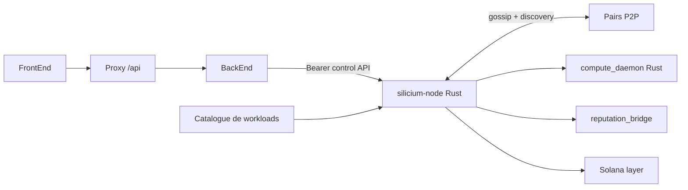
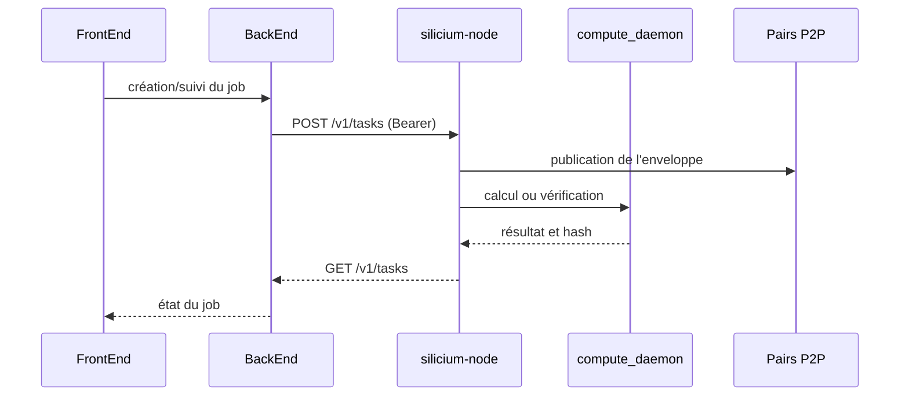

# Schéma du runtime Network

## Architecture active

Le BackEnd n'écrit pas de fichiers d'export pour piloter les nouveaux jobs :
il soumet et suit les tâches via l'API `/v1` de `silicium-node`. Les artefacts
restent dans le plan de données du workload ; l'API est un plan de contrôle.

## Parcours d'une tâche

Consulter [node-control-api.md](node-control-api.md) pour le contrat HTTP et
[p2p-direct-transport-contract.md](p2p-direct-transport-contract.md) pour le
transport entre pairs.
