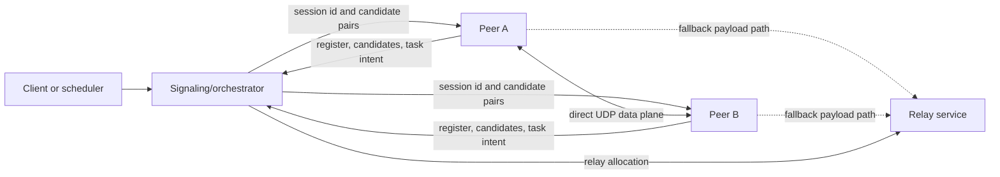
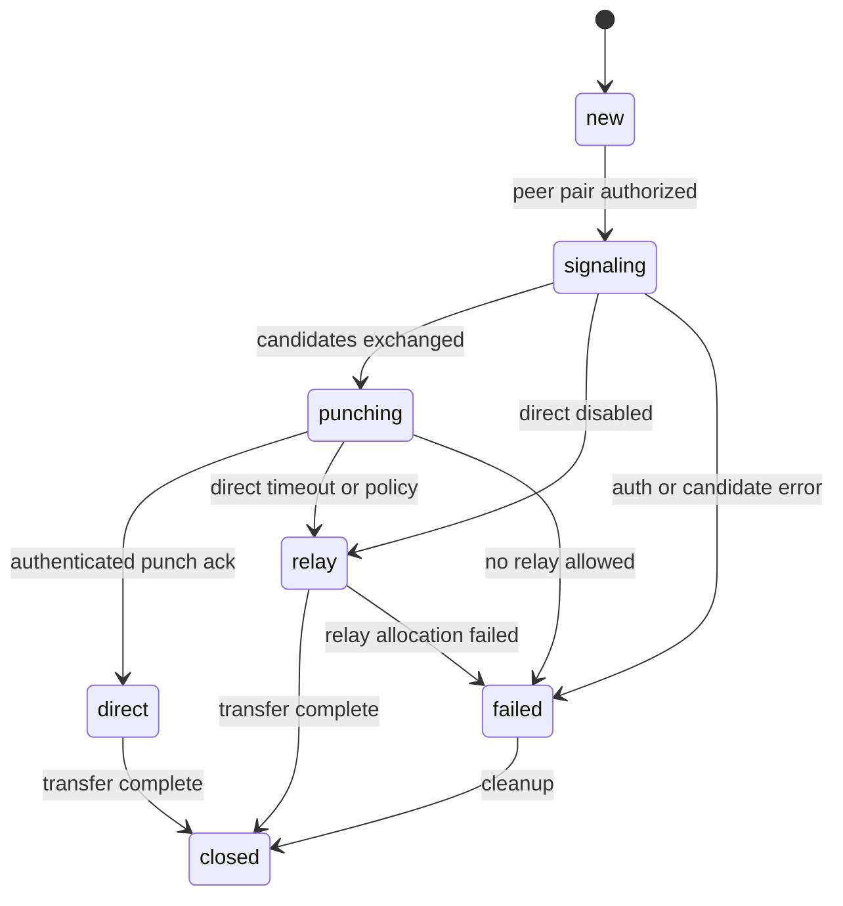

# P2P Direct Transport Contract

Issue: #211

This document defines the target contract for moving Silicium node payload
traffic from orchestrator-mediated HTTP paths to authenticated peer-to-peer
sessions. The orchestrator remains the control and signaling plane. Fragment,
result, verification, and health payloads should use a direct peer data plane
when possible and a relay only when direct connectivity fails.

## Goals

- Keep peer discovery, authorization, task matching, and connection signaling
  server-mediated.
- Move large off-chain payloads to direct peer-to-peer sessions by default.
- Make direct, relay, legacy, and failed transfer paths explicit and observable.
- Preserve compatibility with current `silicium node start` deployments that
  only support peer HTTP, seed peers, mesh sync, and relay fetch.
- Provide stable message schemas for the follow-up implementation issues in the
  P2P milestone.

## Non-goals

- Replacing Solana state, settlement, or on-chain job accounting.
- Removing existing HTTP peer sync or relay behavior in the first rollout.
- Guaranteeing direct connectivity for every NAT topology. Symmetric NAT,
  CGNAT, enterprise firewalls, and UDP-blocked networks may require relay.
- Defining final cryptographic key storage internals. This contract only
  specifies the fields every authenticated message must carry.

## Architecture



### Control and signaling plane

The control plane remains server-mediated. It owns:

- peer registration and liveness;
- peer role, capacity, and reputation metadata;
- candidate publication and expiration;
- authorization for peer pairs and task/session ids;
- direct punch coordination;
- relay allocation and relay quota;
- compatibility with legacy peer HTTP mesh sync.

The control plane must not carry large fragment/result payloads when direct or
relay data paths are available.

### Data plane

The data plane carries:

- fragment input transfer;
- verification input transfer;
- result and proof transfer;
- peer-to-peer health probes;
- bounded retry and acknowledgement traffic.

The preferred data plane order is:

1. Direct peer session.
2. Relay session.
3. Legacy HTTP/orchestrator path when compatibility mode allows it.
4. Structured failure.

## Session State Machine



| State | Owner | Meaning |
| --- | --- | --- |
| `new` | signaling | A peer requested a session for a task or payload. |
| `signaling` | signaling | Peer pair is authorized and candidates are being exchanged. |
| `punching` | peers | Peers are sending bounded UDP punch probes. |
| `direct` | peers | Both peers validated the direct session and selected a candidate pair. |
| `relay` | peers + relay | Direct is unavailable or disabled; payload uses relay. |
| `failed` | peers + signaling | No usable path was established. |
| `closed` | all | Session state and temporary candidates can be cleaned up. |

## Stable Identifiers

Every P2P message uses these identifiers:

- `protocol_version`: integer. Initial version is `1`.
- `message_type`: stable string from the message catalog.
- `session_id`: opaque server-issued id for one peer pair and one purpose.
- `peer_id`: sender peer id.
- `target_peer_id`: intended receiver peer id when applicable.
- `task_id`: task or request id when the session is bound to work.
- `payload_id`: content id, result id, proof id, or health probe id.
- `timestamp_unix_ms`: sender timestamp in milliseconds.
- `nonce`: unique value within the sender/session scope.
- `auth`: signature or MAC envelope covering the canonical message without the
  `auth` field.

Messages that omit any required identifier must be rejected before state
mutation.

## Peer Identity and Handshake

Each node owns a persistent Ed25519 peer identity. The default private key path
is under the node state directory, and headless/world deployments may provide an
explicit `--identity-key-path`. The private key is local node identity material:
it must not be copied into task payloads, logs, or peer announcements. Public
keys are announced with peer metadata so receivers can verify signed messages.

Direct or relay-assisted session setup uses a signed `session_handshake`
payload. The handshake binds:

- session id;
- sender peer id;
- target peer id;
- purpose;
- task id when available;
- sender role claims;
- reputation metadata;
- candidate fingerprints and candidate expiry;
- timestamp and expiry;
- nonce;
- identity id and public key.

Receivers must reject handshakes when the signature is invalid, the nonce has
already been used for the same identity/session, the timestamp is stale, the
target peer id does not match the receiver, the requested task is not authorized,
or any candidate fingerprint has expired.

The legacy shared mesh key remains available for local development only. Bearer
authentication with the mesh key must require an explicit development flag such
as `--identity-dev-mesh-auth` or `SILICIUM_IDENTITY_DEV_MESH_AUTH=1`. Production
peers must authenticate HTTP and mesh messages with peer identity signatures;
the mesh key may add a MAC but must not be the only security boundary.

## Message Catalog

### PeerRegister

Registers a node with the control plane. This does not authorize data transfer.

```json
{
  "protocol_version": 1,
  "message_type": "peer_register",
  "peer_id": "node-a",
  "roles": ["compute", "verify"],
  "capacity": {"cpu_count": 8, "disk_free_bytes": 1000000000},
  "features": ["peer_http", "udp_punch_v1", "relay_v1"],
  "public_key": "base64-or-multibase-key",
  "timestamp_unix_ms": 1784310000000,
  "nonce": "reg-0001",
  "auth": {"scheme": "peer-signature-v1", "value": "base64-signature"}
}
```

### CandidateAnnounce

Publishes short-lived local, server-reflexive, or relay candidates.

```json
{
  "protocol_version": 1,
  "message_type": "candidate_announce",
  "peer_id": "node-a",
  "candidates": [
    {
      "candidate_id": "cand-a-host-1",
      "candidate_type": "host",
      "transport": "udp",
      "address_family": "ipv4",
      "ip": "192.168.1.20",
      "port": 46101,
      "priority": 100,
      "observed_unix_ms": 1784310001000,
      "expires_unix_ms": 1784310061000
    },
    {
      "candidate_id": "cand-a-srflx-1",
      "candidate_type": "srflx",
      "transport": "udp",
      "address_family": "ipv4",
      "ip": "203.0.113.10",
      "port": 52044,
      "priority": 900,
      "observed_unix_ms": 1784310001000,
      "expires_unix_ms": 1784310061000
    }
  ],
  "timestamp_unix_ms": 1784310001000,
  "nonce": "cand-0001",
  "auth": {"scheme": "peer-signature-v1", "value": "base64-signature"}
}
```

Candidate rules:

- `host` candidates may be private and are only useful on the same LAN or VPN.
- `srflx` candidates are server-observed public mappings.
- `relay` candidates are allocated by a relay service and scoped to one
  session.
- Expired candidates must not be offered for new sessions.
- Implementations must mark local/private addresses with `private: true` and
  `internet_routable: false`. A private `host` candidate can be retained for
  LAN/VPN attempts, but it must never be selected as a public Internet
  endpoint.
- Nodes persist their local candidate diagnostics in `p2p.candidates.json`,
  including candidate type, selected candidate, observed public address, and
  coarse NAT behavior.

### DiscoveryObserve

Project-native server-reflexive discovery endpoint. A node sends an
authenticated `GET /discovery/observe` request to a signaling/discovery peer.
The receiver returns the source address it observed for that request:

```json
{
  "schema_version": 1,
  "node_id": "seed-eu-1",
  "observed_ip": "203.0.113.10",
  "observed_port": 52044,
  "timestamp_unix": 1784310001
}
```

The observed TCP source port is diagnostic. Unless a UDP mapping is explicitly
measured, the advertised UDP candidate port remains the node's configured UDP
punch/gossip port.

### SessionRequest

Requests a session with another peer for a specific purpose.

```json
{
  "protocol_version": 1,
  "message_type": "session_request",
  "peer_id": "node-a",
  "target_peer_id": "node-b",
  "purpose": "fragment_fetch",
  "task_id": "compute:42",
  "payload_id": "sha256:abc123",
  "allowed_transports": ["direct", "relay", "legacy"],
  "timestamp_unix_ms": 1784310002000,
  "nonce": "sess-0001",
  "auth": {"scheme": "peer-signature-v1", "value": "base64-signature"}
}
```

The signaling plane must reject requests when:

- the peer pair is not authorized for the task or payload;
- either peer is stale or banned;
- no compatible feature set exists;
- the task/session has already reached a terminal state.

### PunchStart

Instructs both peers to attempt simultaneous UDP punching.

```json
{
  "protocol_version": 1,
  "message_type": "punch_start",
  "session_id": "p2p-sess-01",
  "peer_id": "signaling",
  "initiator_peer_id": "node-a",
  "target_peer_id": "node-b",
  "candidate_pairs": [
    {
      "local_candidate_id": "cand-a-srflx-1",
      "remote_candidate_id": "cand-b-srflx-1",
      "transport": "udp",
      "priority": 1000
    }
  ],
  "retry": {"count": 8, "interval_ms": 120, "timeout_ms": 2500},
  "timestamp_unix_ms": 1784310003000,
  "nonce": "punch-start-0001",
  "auth": {"scheme": "signaling-signature-v1", "value": "base64-signature"}
}
```

### SessionHandshake

Authenticates one direct or relay-assisted session attempt.

```json
{
  "schema_version": 1,
  "message_type": "session_handshake",
  "session_id": "p2p-sess-01",
  "peer_id": "node-a",
  "target_peer_id": "node-b",
  "purpose": "fragment_fetch",
  "task_id": "compute:42",
  "roles": ["compute"],
  "reputation_score": 25.0,
  "onchain_reputation": 0.0,
  "candidate_fingerprints": [
    {"candidate_id": "cand-a-srflx-1", "expires_unix": 1784310061}
  ],
  "timestamp_unix": 1784310001,
  "expires_unix": 1784310301,
  "nonce": "8f4c0c0a15f04f9d8c26a50a083fbe12",
  "identity_id": "sha256-prefix",
  "public_key": "base64-pem",
  "signature": "hex-ed25519-signature"
}
```

### PunchProbe

Sent by peers over UDP to open NAT mappings and prove session possession.

```json
{
  "protocol_version": 1,
  "message_type": "punch_probe",
  "session_id": "p2p-sess-01",
  "peer_id": "node-a",
  "target_peer_id": "node-b",
  "candidate_id": "cand-a-srflx-1",
  "timestamp_unix_ms": 1784310003100,
  "nonce": "probe-0001",
  "auth": {"scheme": "peer-signature-v1", "value": "base64-signature"}
}
```

### PunchAck

Confirms that the receiver validated the probe for the expected session.

```json
{
  "protocol_version": 1,
  "message_type": "punch_ack",
  "session_id": "p2p-sess-01",
  "peer_id": "node-b",
  "target_peer_id": "node-a",
  "selected_remote_candidate_id": "cand-a-srflx-1",
  "selected_local_candidate_id": "cand-b-srflx-1",
  "rtt_ms": 42,
  "timestamp_unix_ms": 1784310003142,
  "nonce": "ack-0001",
  "auth": {"scheme": "peer-signature-v1", "value": "base64-signature"}
}
```

### TransferBegin

Starts a payload transfer over an established direct or relay session.

```json
{
  "protocol_version": 1,
  "message_type": "transfer_begin",
  "session_id": "p2p-sess-01",
  "peer_id": "node-a",
  "target_peer_id": "node-b",
  "task_id": "compute:42",
  "payload_id": "sha256:abc123",
  "payload_kind": "fragment_input",
  "size_bytes": 4096,
  "content_hash": "sha256:abc123",
  "transport": "direct",
  "timestamp_unix_ms": 1784310004000,
  "nonce": "xfer-0001",
  "auth": {"scheme": "peer-signature-v1", "value": "base64-signature"}
}
```

### TransferComplete

Acknowledges transfer integrity and terminal transfer status.

```json
{
  "protocol_version": 1,
  "message_type": "transfer_complete",
  "session_id": "p2p-sess-01",
  "peer_id": "node-b",
  "target_peer_id": "node-a",
  "task_id": "compute:42",
  "payload_id": "sha256:abc123",
  "transport": "direct",
  "ok": true,
  "duration_ms": 84,
  "content_hash": "sha256:abc123",
  "timestamp_unix_ms": 1784310004084,
  "nonce": "xfer-done-0001",
  "auth": {"scheme": "peer-signature-v1", "value": "base64-signature"}
}
```

### SessionResult

Reports the selected path or final failure to the signaling plane.

```json
{
  "protocol_version": 1,
  "message_type": "session_result",
  "session_id": "p2p-sess-01",
  "peer_id": "node-a",
  "target_peer_id": "node-b",
  "state": "direct",
  "transport": "direct",
  "failure_reason": "",
  "selected_candidate_pair": {
    "local_candidate_id": "cand-a-srflx-1",
    "remote_candidate_id": "cand-b-srflx-1"
  },
  "timestamp_unix_ms": 1784310004100,
  "nonce": "sess-result-0001",
  "auth": {"scheme": "peer-signature-v1", "value": "base64-signature"}
}
```

Failure reasons are stable strings. Initial values:

- `auth_failed`
- `candidate_expired`
- `candidate_unreachable`
- `direct_timeout`
- `relay_unavailable`
- `relay_denied`
- `legacy_disabled`
- `payload_hash_mismatch`
- `task_not_authorized`
- `protocol_version_unsupported`

## Direct Path

Direct transfer is selected when:

1. both peers advertise `udp_punch_v1`;
2. signaling authorizes the peer pair for the specific task or payload;
3. at least one candidate pair remains valid;
4. both peers validate `PunchProbe` and `PunchAck`;
5. the transfer integrity check succeeds.

Direct payload transfer must record:

- `session_id`;
- source and target peer ids;
- selected candidate ids;
- RTT;
- transfer duration;
- content hash;
- terminal result.

## Relay Path

Relay transfer is selected when:

- policy disables direct transfer;
- direct punching times out;
- no valid public candidate pair exists;
- a peer is known to require relay;
- direct failed and relay is allowed by `allowed_transports`.

Relay sessions are scoped to one peer pair and one task or payload. A relay must
not accept arbitrary unauthenticated fetches. It must enforce session expiry,
quota, and authorization from the signaling plane.

## Failure Path

A session fails when no direct, relay, or permitted legacy path completes. Failure
must be explicit and observable. Nodes must write a terminal event containing:

- `session_id`;
- peer ids;
- task or payload id;
- last state;
- failure reason;
- elapsed time;
- whether retry is allowed.

Failed sessions must not mark tasks or payload transfers as completed.

## Rollout Flags

Initial rollout flags and environment variables:

| CLI flag | Environment variable | Default | Purpose |
| --- | --- | --- | --- |
| `--p2p-transport-mode` | `SILICIUM_P2P_TRANSPORT_MODE` | `legacy` | `legacy`, `relay`, `direct`, or `auto`. |
| `--nat-punch-enable` | `SILICIUM_NAT_PUNCH_ENABLE` | `0` | Enables direct UDP punch attempts. |
| `--relay-enable` | `SILICIUM_RELAY_ENABLE` | `0` | Allows this node to act as a relay. |
| `--relay-policy` | `SILICIUM_RELAY_POLICY` | `fallback` | `disabled`, `fallback`, or `force`. |
| `--p2p-bind-udp` | `SILICIUM_P2P_BIND_UDP` | `0.0.0.0:0` | UDP bind address for direct sessions. |
| `--p2p-candidate-ttl-s` | `SILICIUM_P2P_CANDIDATE_TTL_S` | `60` | Candidate expiration window. |
| `--p2p-candidate-refresh-s` | `SILICIUM_P2P_CANDIDATE_REFRESH_S` | `20` | Candidate refresh interval. |
| `--p2p-session-timeout-ms` | `SILICIUM_P2P_SESSION_TIMEOUT_MS` | `2500` | Direct setup timeout. |
| `--p2p-legacy-fallback` | `SILICIUM_P2P_LEGACY_FALLBACK` | `1` | Allows current HTTP paths during rollout. |

The existing `--nat-punch-enable`, `--relay-enable`, and peer HTTP flags remain
valid. New flags must be additive and default to current behavior until the
network is ready for `auto`.

## Backward Compatibility

Legacy peers are peers that do not advertise `udp_punch_v1`.

Compatibility rules:

- Legacy peers may still sync through peer HTTP and seed peers.
- Legacy peers must not receive `PunchStart`.
- A modern peer may request `legacy` fallback when a task allows it.
- If `SILICIUM_P2P_LEGACY_FALLBACK=0`, legacy-only peers are skipped for direct
  P2P tasks and the session fails with `protocol_version_unsupported` or
  `legacy_disabled`.
- Relay fallback may be used between one modern peer and one legacy peer only
  when the relay endpoint supports the legacy payload fetch contract.

## Observability

Nodes must emit structured events for:

- peer registration;
- candidate announce;
- session request;
- punch start;
- punch probe sent;
- punch ack received;
- direct selected;
- relay selected;
- transfer begin;
- transfer complete;
- session failure;
- session close.

The desktop and dashboard integrations should be able to distinguish:

- `transport=direct`;
- `transport=relay`;
- `transport=legacy`;
- `transport=failed`.

Recommended export file additions:

- `p2p.sessions.ndjson`;
- `p2p.candidates.json`;
- `p2p.status.json`;

## Implementation Order

1. Peer identity and authenticated handshake.
2. NAT discovery and candidate gathering.
3. Signaling endpoints and session state.
4. UDP punching and direct session establishment.
5. Data transfer abstraction for direct, relay, and legacy.
6. Relay allocation and quotas.
7. Desktop diagnostics and rollout flags.
8. Deterministic NAT traversal test harness.

## Acceptance Mapping

This document satisfies issue #211 by defining:

- target architecture and state machines;
- stable message field names and JSON examples;
- direct, relay, and failure paths;
- rollout flags;
- backward compatibility with current HTTP/orchestrator behavior.
